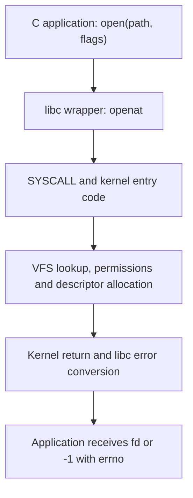
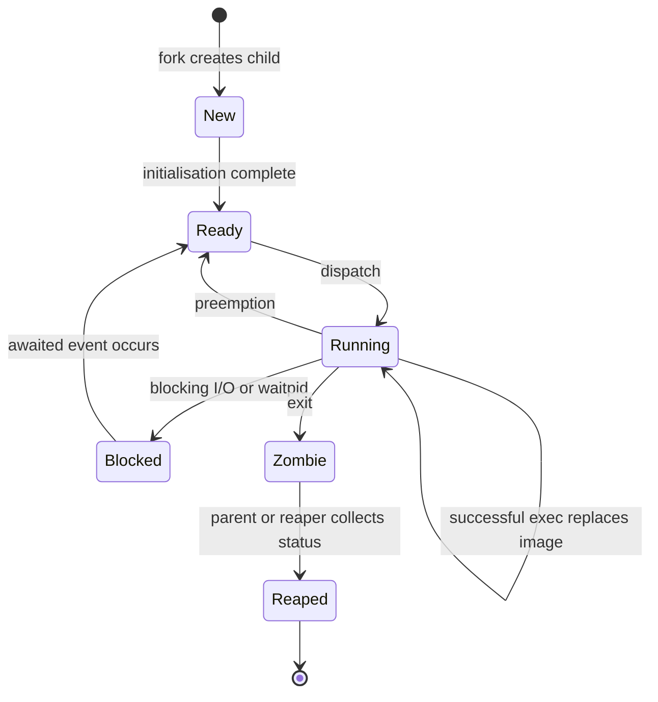

# OS — Exercises, Diagrams and Exam Questions

## Part 1: Weeks 1–4 (Introduction, Syscalls, Processes, Scheduling)

> by Revolvix | ASE Bucharest — CSIE

### Difficulty Legend

| Symbol | Level | Time | Description |
|--------|-------|------|-------------|
| ⭐ | Easy | 3–5 min | Basic recall and understanding |
| ⭐⭐ | Medium | 5–10 min | Application of concepts |
| ⭐⭐⭐ | Hard | 10–15 min | Analysis and calculation |
| ⭐⭐⭐⭐ | Expert | 15–20 min | Evaluation and design |

> 💡 **Study tip:** Work through exercises without looking at solutions first. Time yourself — exam questions should take approximately 5 minutes each.

---

# WEEK 1: Introduction to OS

## Detailed ASCII Diagrams

### Diagram 1.1: Layers of a Computing System

```
┌─────────────────────────────────────────────────────────────────────────┐
│                                                                         │
│    👤 USER                                                              │
│    ┌─────────────────────────────────────────────────────────────────┐  │
│    │  Interface: CLI (bash), GUI (GNOME), Voice, Touch               │  │
│    └────────────────────────────┬────────────────────────────────────┘  │
│                                 │                                        │
│                                 ▼                                        │
│    📦 APPLICATIONS                                                       │
│    ┌────────────────────────────────────────────────────────────────┐   │
│    │  Browser │ Editor │ Compiler   │ Games  │ Office │ Media      │   │
│    │  Chrome  │ VSCode │ gcc        │ Steam  │ Libre  │ VLC        │   │
│    └────────────────────────────┬───────────────────────────────────┘   │
│                                 │                                        │
│                                 │ System Calls                           │
│                                 │ (read, write, fork, exec...)           │
│                                 ▼                                        │
│    🖥️ OPERATING SYSTEM                                                   │
│    ┌────────────────────────────────────────────────────────────────┐   │
│    │  ┌──────────────────────────────────────────────────────────┐  │   │
│    │  │                    KERNEL                                 │  │   │
│    │  │  ┌────────────┐ ┌────────────┐ ┌────────────┐           │  │   │
│    │  │  │  Process   │ │  Memory    │ │   File     │           │  │   │
│    │  │  │  Manager   │ │  Manager   │ │   System   │           │  │   │
│    │  │  │            │ │            │ │            │           │  │   │
│    │  │  │ scheduler  │ │ paging     │ │ ext4, VFS  │           │  │   │
│    │  │  │ fork/exec  │ │ virtual    │ │ inodes     │           │  │   │
│    │  │  │ signals    │ │ allocation │ │ dirs       │           │  │   │
│    │  │  └────────────┘ └────────────┘ └────────────┘           │  │   │
│    │  │  ┌────────────┐ ┌────────────┐ ┌────────────┐           │  │   │
│    │  │  │   I/O      │ │  Network   │ │  Security  │           │  │   │
│    │  │  │  Manager   │ │   Stack    │ │  Module    │           │  │   │
│    │  │  │            │ │            │ │            │           │  │   │
│    │  │  │ drivers    │ │ TCP/IP     │ │ SELinux    │           │  │   │
│    │  │  │ buffering  │ │ sockets    │ │ AppArmor   │           │  │   │
│    │  │  │ scheduling │ │ firewall   │ │ cgroups    │           │  │   │
│    │  │  └────────────┘ └────────────┘ └────────────┘           │  │   │
│    │  └──────────────────────────────────────────────────────────┘  │   │
│    └────────────────────────────┬───────────────────────────────────┘   │
│                                 │                                        │
│                                 │ Hardware Abstraction Layer (HAL)       │
│                                 │ Device drivers                         │
│                                 ▼                                        │
│    ⚙️ HARDWARE                                                           │
│    ┌────────────────────────────────────────────────────────────────┐   │
│    │  ┌─────────┐ ┌─────────┐ ┌─────────┐ ┌─────────┐ ┌─────────┐  │   │
│    │  │   CPU   │ │   RAM   │ │  Disk   │ │   GPU   │ │ Network │  │   │
│    │  │ 8 cores │ │  16GB   │ │ 1TB SSD │ │  RTX    │ │  1Gbps  │  │   │
│    │  │ 3.6GHz  │ │ DDR5    │ │ NVMe    │ │  4070   │ │  eth0   │  │   │
│    │  └─────────┘ └─────────┘ └─────────┘ └─────────┘ └─────────┘  │   │
│    │  ┌─────────┐ ┌─────────┐ ┌─────────┐ ┌─────────┐ ┌─────────┐  │   │
│    │  │Keyboard │ │  Mouse  │ │ Display │ │  Audio  │ │   USB   │  │   │
│    │  │  HID    │ │  HID    │ │ HDMI/DP │ │ ALSA    │ │  3.2    │  │   │
│    │  └─────────┘ └─────────┘ └─────────┘ └─────────┘ └─────────┘  │   │
│    └────────────────────────────────────────────────────────────────┘   │
│                                                                         │
└─────────────────────────────────────────────────────────────────────────┘
```

### Diagram 1.2: Evolution of Operating Systems

```
════════════════════════════════════════════════════════════════════════════
                    TIMELINE - OS EVOLUTION
════════════════════════════════════════════════════════════════════════════

1950        1960        1970        1980        1990        2000        2010
  │           │           │           │           │           │           │
  ▼           ▼           ▼           ▼           ▼           ▼           ▼

┌─────────────────────────────────────────────────────────────────────────┐
│ GENERATION 1: No OS (1945-1955)                                         │
│ ═══════════════════════════════                                         │
│                                                                         │
│   [Punched cards] ──► [Computer] ──► [Printer]                         │
│                                                                         │
│   • Machine code programming                                            │
│   • One programme at a time                                             │
│   • Fully manual operation                                              │
│   • CPU utilisation: ~30%                                               │
└─────────────────────────────────────────────────────────────────────────┘
                                    │
                                    ▼
┌─────────────────────────────────────────────────────────────────────────┐
│ GENERATION 2: Batch Processing (1955-1965)                              │
│ ══════════════════════════════════════════                              │
│                                                                         │
│   [Job 1]─┐                                                            │
│   [Job 2]─┼──► [Batch Monitor] ──► [Execution] ──► [Output]            │
│   [Job 3]─┘                                                            │
│                                                                         │
│   • GM-NAA I/O (1956) - the first OS                                   │
│   • Automatic transition between jobs                                   │
│   • CPU utilisation: ~90%                                               │
│   • No interactivity                                                    │
└─────────────────────────────────────────────────────────────────────────┘
                                    │
                                    ▼
┌─────────────────────────────────────────────────────────────────────────┐
│ GENERATION 3: Multiprogramming & Time-Sharing (1965-1980)               │
│ ══════════════════════════════════════════════════════════              │
│                                                                         │
│   ┌──────────────────────────────────────────┐                         │
│   │  CPU Timeline                            │                         │
│   │  ┌───┐┌───┐┌───┐┌───┐┌───┐┌───┐         │                         │
│   │  │ A ││ B ││ C ││ A ││ B ││ C │ ...     │                         │
│   │  └───┘└───┘└───┘└───┘└───┘└───┘         │                         │
│   │        Time Quantum (e.g. 100ms)         │                         │
│   └──────────────────────────────────────────┘                         │
│                                                                         │
│   • CTSS (1961), Multics (1969), UNIX (1969)                          │
│   • Multiple users simultaneously                                       │
│   • Illusion of parallelism                                            │
│   • Interactivity!                                                      │
└─────────────────────────────────────────────────────────────────────────┘
                                    │
                                    ▼
┌─────────────────────────────────────────────────────────────────────────┐
│ GENERATION 4: PC & GUI (1980-2000)                                      │
│ ══════════════════════════════════                                      │
│                                                                         │
│   ┌─────────────────────────────────────────────┐                      │
│   │  ┌─────────────────────────────────────┐   │                      │
│   │  │ 📁 File  📝 Edit  👁 View  ❓ Help │   │  GUI                   │
│   │  ├─────────────────────────────────────┤   │                      │
│   │  │  📂 Documents                        │   │                      │
│   │  │  📂 Pictures                         │   │                      │
│   │  │  📄 readme.txt                       │   │                      │
│   │  └─────────────────────────────────────┘   │                      │
│   └─────────────────────────────────────────────┘                      │
│                                                                         │
│   • MS-DOS (1981), Windows (1985), Mac OS (1984)                       │
│   • Linux (1991) - Open Source                                         │
│   • Single user, multitasking                                          │
│   • GUI becomes standard                                                │
└─────────────────────────────────────────────────────────────────────────┘
                                    │
                                    ▼
┌─────────────────────────────────────────────────────────────────────────┐
│ GENERATION 5: Mobile & Cloud (2000-present)                             │
│ ═══════════════════════════════════════════                             │
│                                                                         │
│   📱 Mobile        ☁️ Cloud              🐳 Containers                  │
│   ┌─────────┐     ┌─────────────┐       ┌─────────────┐                │
│   │ Android │     │    AWS      │       │   Docker    │                │
│   │   iOS   │     │   Azure     │       │ Kubernetes  │                │
│   │         │     │   GCP       │       │             │                │
│   └─────────┘     └─────────────┘       └─────────────┘                │
│                                                                         │
│   • iOS (2007), Android (2008)                                         │
│   • Cloud computing, virtualisation                                     │
│   • Containers, microservices                                          │
│   • Edge computing, IoT                                                │
└─────────────────────────────────────────────────────────────────────────┘
```

---

## Solved Exercises

### Exercise 1.1: Identifying OS Functions

Task: For each scenario, identify the OS function involved.

| # | Scenario | OS Function | Explanation |
|---|----------|-------------|-------------|
| a | You launch Chrome and Word simultaneously | Process management | OS creates separate processes and schedules execution |
| b | You save a document to disc | File management | OS writes data to the file system |
| c | Chrome cannot read Word's data | Memory protection | OS isolates address spaces |
| d | You read from a USB drive | I/O management | OS communicates with the USB driver |
| e | You authenticate with a password | Security | OS verifies credentials |

---

### Exercise 1.2: OS Classification

Task: Classify the following operating systems and justify.

| OS | Type | Justification |
|----|------|---------------|
| Windows 11 | Desktop, Hybrid | GUI focus, NT hybrid kernel |
| Ubuntu Server | Server, Monolithic | No GUI, monolithic Linux kernel |
| FreeRTOS | RTOS, Embedded | Real-time, for microcontrollers |
| Android | Mobile, Linux-based | Smartphones, modified Linux kernel |
| macOS | Desktop, Hybrid | XNU kernel (Mach microkernel + BSD) |

---

### Exercise 1.3: Batch Processing Calculation

Problem: A batch system processes 5 jobs with the following times:
- Job A: 10 minutes
- Job B: 5 minutes  
- Job C: 15 minutes
- Job D: 8 minutes
- Job E: 12 minutes

Requirements:
1. Calculate the total processing time
2. Calculate the average turnaround time
3. Calculate the average waiting time

Solution:

```
Gantt Chart (FCFS, order A-B-C-D-E):
┌──────────┬─────┬───────────────┬────────┬────────────┐
│    A     │  B  │      C        │   D    │     E      │
└──────────┴─────┴───────────────┴────────┴────────────┘
0         10    15              30       38           50

1. Total time = 10 + 5 + 15 + 8 + 12 = 50 minutes

2. Turnaround time (completion - arrival, all arrive at t=0):
   - A: 10 - 0 = 10 min
   - B: 15 - 0 = 15 min
   - C: 30 - 0 = 30 min
   - D: 38 - 0 = 38 min
   - E: 50 - 0 = 50 min
   
   Average = (10 + 15 + 30 + 38 + 50) / 5 = 143 / 5 = 28.6 minutes

3. Waiting time (turnaround - burst):
   - A: 10 - 10 = 0 min
   - B: 15 - 5 = 10 min
   - C: 30 - 15 = 15 min
   - D: 38 - 8 = 30 min
   - E: 50 - 12 = 38 min
   
   Average = (0 + 10 + 15 + 30 + 38) / 5 = 93 / 5 = 18.6 minutes
```

---

## Exam-Style Questions

### Multiple Choice Questions (1 point each)

1.1 Which of the following is NOT a primary function of the OS?
- a) Memory management
- b) Programme compilation ✓
- c) Process management
- d) I/O management

Answer: b) - The compiler is an application programme, not an OS function.

---

1.2 In what year was UNIX created?
- a) 1956
- b) 1969 ✓
- c) 1981
- d) 1991

Answer: b) - 1969, by Ken Thompson and Dennis Ritchie at Bell Labs.

---

1.3 Which kernel architecture allows a network driver to crash without affecting the rest of the system?
- a) Monolithic kernel
- b) Microkernel ✓
- c) Hybrid kernel
- d) Exokernel

Answer: b) - In a microkernel, drivers run in user space as separate servers.

---

### Extended Answer Questions (3-5 points)

1.4 (3p) Explain the difference between monolithic kernel and microkernel, giving an example OS for each.

Model answer:

| Aspect | Monolithic Kernel | Microkernel |
|--------|-------------------|-------------|
| Structure | All kernel code in the same space | Only minimal functions in kernel |
| Components in kernel | Scheduler, MM, FS, drivers | Only IPC, basic scheduling |
| Communication | Direct function calls | Message passing (IPC) |
| Performance | Faster (no IPC overhead) | Overhead for messages |
| Reliability | A bug can crash the entire system | Isolation - components can crash separately |
| Example | Linux, FreeBSD | Minix, QNX, seL4 |

---

1.5 (5p) A batch processing system receives 4 jobs in the order: J1(burst=6), J2(burst=2), J3(burst=8), J4(burst=3). All arrive at t=0.

a) Draw the Gantt chart for FCFS
b) Calculate the average waiting time for FCFS
c) How would it change if we use SJF? Calculate the new average waiting time.
d) What conclusion do you draw?

Model answer:

```
a) FCFS Gantt Chart:
┌────────┬────┬──────────┬─────┐
│   J1   │ J2 │    J3    │ J4  │
│   6    │ 2  │    8     │  3  │
└────────┴────┴──────────┴─────┘
0        6    8         16    19

b) FCFS Waiting times:
   J1: 0
   J2: 6
   J3: 8
   J4: 16
   Average = (0 + 6 + 8 + 16) / 4 = 30 / 4 = 7.5 minutes

c) SJF (order by burst: J2, J4, J1, J3):
┌────┬─────┬────────┬──────────┐
│ J2 │ J4  │   J1   │    J3    │
│ 2  │  3  │   6    │    8     │
└────┴─────┴────────┴──────────┘
0    2     5       11         19

SJF Waiting times:
   J1: 5
   J2: 0
   J3: 11
   J4: 2
   Average = (5 + 0 + 11 + 2) / 4 = 18 / 4 = 4.5 minutes

d) Conclusion: SJF reduces average waiting time from 7.5 to 4.5 minutes 
   (40% reduction), confirming the minimum for this all-ready workload with known bursts,
   non-preemptive execution and no switching overhead.
```

---

# WEEK 2: System Calls

## Detailed ASCII Diagrams

### Diagram 2.1: System Call Mechanism (Linux x86-64 model)

The C library API and the raw system call ABI are separate interfaces. The
following path describes a Linux x86-64 `open()` wrapper that uses `openat()`;
glibc's Linux implementation uses this route. A direct raw `open` example
would use syscall number 2 instead. Other ABIs and libc versions need their
own register and syscall-number tables.



| Register | `openat` raw syscall arguments | Direct `open` alternative |
|---|---|---|
| `rax` | 257 | 2 |
| `rdi` | `AT_FDCWD` (-100) | pathname pointer |
| `rsi` | pathname pointer | flags |
| `rdx` | flags | mode, when required |
| `r10` | mode, when required | unused |

1. The application calls the libc function with the C calling convention.
2. The wrapper prepares the raw ABI registers and executes `SYSCALL`.
3. Hardware records the return instruction pointer in `RCX` and flags in
   `R11`, changes privilege and transfers to the configured kernel entry.
   `SYSCALL` does **not** load `RSP` from the TSS.
4. Kernel entry software preserves the user stack pointer, switches to an
   appropriate kernel stack and saves the register context.
5. The kernel validates/dispatches the syscall number. Internal handler
   names and dispatch implementations vary across kernel versions.
6. The open path obtains the user pathname safely; user pointers cannot be
   dereferenced as trusted kernel pointers.
7. VFS pathname lookup, access checks, file-object creation and descriptor
   allocation are performed. Their internal ordering is implementation-specific.
8. Success returns a descriptor in `RAX`; it need not be 3 because earlier
   descriptors may be closed. Linux raw errors use the reserved negative
   errno range, commonly -4095 through -1.
9. Return processing handles pending work, including signals or scheduling
   where needed, and restores the saved context.
10. Software restores the user stack pointer. `SYSRET` (or an `IRET` path
    when needed) returns to user mode; `SYSRET` itself does not restore `RSP`.
11. The libc wrapper translates a raw error into return value -1 and `errno`.
12. The application checks the result, uses the descriptor on success and
    closes it when finished. The fd indexes its descriptor table; it is not
    a direct inode or physical-disc address.

Implementation references: [Linux x86-64 entry source](https://github.com/torvalds/linux/blob/v6.6/arch/x86/entry/entry_64.S),
[glibc Linux open64 wrapper](https://codebrowser.dev/glibc/glibc/sysdeps/unix/sysv/linux/open64.c.html)
and [Linux syscall ABI](https://man7.org/linux/man-pages/man2/syscall.2.html).
This is a source-based explanation, not a captured `strace` or kernel execution.

### Diagram 2.2: System Call Categories

The names below group operating-system **APIs** by purpose. Some are libc
functions rather than direct system calls: `opendir`/`readdir` use lower-level
operations, and some time queries may use a vDSO path without entering the kernel.

```
═══════════════════════════════════════════════════════════════════════════
                    SYSTEM CALL CATEGORIES
═══════════════════════════════════════════════════════════════════════════

┌─────────────────────────────────────────────────────────────────────────┐
│                           SYSTEM CALLS                                  │
└───────────────────────────────┬─────────────────────────────────────────┘
                                │
        ┌───────────────────────┼───────────────────────┐
        │                       │                       │
        ▼                       ▼                       ▼
┌───────────────┐       ┌───────────────┐       ┌───────────────┐
│   PROCESSES   │       │     FILES     │       │    MEMORY     │
├───────────────┤       ├───────────────┤       ├───────────────┤
│ fork()        │       │ open()        │       │ brk()         │
│ exec()        │       │ close()       │       │ mmap()        │
│ exit()        │       │ read()        │       │ munmap()      │
│ wait()        │       │ write()       │       │ mprotect()    │
│ clone()       │       │ lseek()       │       │ mlock()       │
│ getpid()      │       │ stat()        │       │ mremap()      │
│ getppid()     │       │ fstat()       │       │               │
│ nice()        │       │ dup()         │       │               │
│ kill()        │       │ pipe()        │       │               │
└───────────────┘       └───────────────┘       └───────────────┘

        ┌───────────────────────┼───────────────────────┐
        │                       │                       │
        ▼                       ▼                       ▼
┌───────────────┐       ┌───────────────┐       ┌───────────────┐
│  DIRECTORIES  │       │    NETWORK    │       │   DEVICES     │
├───────────────┤       ├───────────────┤       ├───────────────┤
│ mkdir()       │       │ socket()      │       │ ioctl()       │
│ rmdir()       │       │ bind()        │       │ select()      │
│ chdir()       │       │ listen()      │       │ poll()        │
│ getcwd()      │       │ accept()      │       │ epoll_*()     │
│ opendir()     │       │ connect()     │       │               │
│ readdir()     │       │ send()        │       │               │
│ link()        │       │ recv()        │       │               │
│ unlink()      │       │ shutdown()    │       │               │
│ rename()      │       │               │       │               │
└───────────────┘       └───────────────┘       └───────────────┘

        ┌───────────────────────┴───────────────────────┐
        │                                               │
        ▼                                               ▼
┌───────────────┐                               ┌───────────────┐
│    SIGNALS    │                               │     TIME      │
├───────────────┤                               ├───────────────┤
│ signal()      │                               │ time()        │
│ sigaction()   │                               │ gettimeofday()│
│ sigprocmask() │                               │ clock_gettime()
│ sigsuspend()  │                               │ nanosleep()   │
│ sigpending()  │                               │ alarm()       │
│ sigwait()     │                               │ setitimer()   │
└───────────────┘                               └───────────────┘
```

---

## Solved Exercises

### Exercise 2.1: strace Analysis

Task: Analyse the output of `strace ls /tmp` and identify each syscall category.

```bash
$ strace ls /tmp 2>&1 | head -20

execve("/bin/ls", ["ls", "/tmp"], 0x7fff...) = 0
brk(NULL)                                = 0x55a8...
openat(AT_FDCWD, "/etc/ld.so.cache", O_RDONLY|O_CLOEXEC) = 3
fstat(3, {st_mode=S_IFREG|0644, ...})    = 0
mmap(NULL, 123456, PROT_READ, ...)       = 0x7f...
close(3)                                 = 0
openat(AT_FDCWD, "/lib/x86_64.../libc.so.6", O_RDONLY) = 3
read(3, "\177ELF...", 832)               = 832
close(3)                                 = 0
...
openat(AT_FDCWD, "/tmp", O_RDONLY|O_DIRECTORY) = 3
getdents64(3, /* 5 entries */, 32768)    = 152
write(1, "file1.txt  file2.txt\n", 22)   = 22
close(3)                                 = 0
exit_group(0)                            = ?
```

Solution:

| Syscall | Category | Purpose |
|---------|----------|---------|
| `execve` | Processes | Loads and executes the `/bin/ls` binary |
| `brk` | Memory | Allocates/deallocates heap |
| `openat` | Files | Opens file/directory |
| `fstat` | Files | Gets file metadata |
| `mmap` | Memory | Maps memory (loads libraries) |
| `close` | Files | Closes file descriptor |
| `read` | Files | Reads from file descriptor |
| `getdents64` | Directories | Reads directory entries |
| `write` | Files | Writes output to stdout (fd=1) |
| `exit_group` | Processes | Terminates the process |

---

### Exercise 2.2: EAT (Effective Access Time) Calculation

Problem: A system has:
- Memory access time: 100 ns
- Syscall overhead (user↔kernel transition): 500 ns
- Kernel processing time: 200 ns

Calculate the effective time for:
a) Direct memory access (local variable)
b) A `getpid()` syscall (no disc access)
c) A `read()` syscall that reads from cache

Solution:

```
a) Direct memory access:
   T = 100 ns
   (Only one RAM access)

b) getpid():
   T = overhead_user→kernel + processing + overhead_kernel→user
   T = 500 + 200 + 500 = 1200 ns
   
   (12x slower than memory access!)

c) read() from cache:
   T = overhead_user→kernel + kernel_processing + cache_access + overhead_kernel→user
   T = 500 + 200 + 100 + 500 = 1300 ns
   
   (Similar to getpid, just one additional memory access for cached data)
```

---

## Exam-Style Questions

### Multiple Choice Questions

2.1 What x86-64 instruction triggers a system call in modern Linux?
- a) int 0x80
- b) sysenter
- c) syscall ✓
- d) trap

Answer: c) - `syscall` is the standard instruction on x86-64.

---

2.2 Where is the syscall number when the `syscall` instruction is executed?
- a) In memory
- b) On the stack
- c) In the %rdi register
- d) In the %rax register ✓

Answer: d) - Linux convention: syscall number in %rax.

---

2.3 What does `fork()` return in the child process?
- a) The child's PID
- b) The parent's PID
- c) 0 ✓
- d) -1

Answer: c) - The parent receives the child's PID; the child receives 0.

---

### Extended Answer Questions

2.4 (5p) Explain why system calls need to exist. Why can't applications access hardware directly?

Model answer:

System calls are necessary for several fundamental reasons:

1. Protection (2p):
   - Without syscalls, any application could access any memory area
   - A bug or malicious programme could corrupt other processes' data or the kernel's
   - Syscalls allow the kernel to verify permissions before each operation

2. Abstraction (1.5p):
   - Applications don't need to know hardware details
   - The same code works on different types of discs, network cards, etc.
   - The kernel provides a uniform interface (POSIX)

3. Coordination (1.5p):
   - Multiple processes want to access the same resource (disc, network)
   - The kernel serialises access and prevents conflicts
   - Ensures fairness in resource allocation

Concrete example: Without syscalls, two processes could write simultaneously to the same disc sector, corrupting each other's data.

---

# WEEK 3: Processes

## Detailed ASCII Diagrams

### Diagram 3.1: Complete State Diagram

This single-CPU teaching model distinguishes ready and running. Linux's
`TASK_RUNNING` covers both runnable and currently running tasks.



A ready queue may contain P2, P5 and P3. Separate waiting queues can contain
P7/P9/P12 for disc I/O, P4/P8 for networking, P6 for a pipe and P10/P11 for a
timer. Event completion makes a task ready; it does not terminate it or give
it the CPU immediately. A blocking `wait`/`waitpid` waits for a child's status;
`fork` creates the child. Successful `exec` preserves the process identity
and replaces its image. A zombie retains exit/accounting information until
reaped; it is not executing. Signal dispositions and automatic reaping can
alter the visible zombie interval. These abstract states are not a complete
listing of Linux internal task states.

References: [fork](https://man7.org/linux/man-pages/man2/fork.2.html),
[execve](https://man7.org/linux/man-pages/man2/execve.2.html) and
[wait](https://man7.org/linux/man-pages/man2/wait.2.html).

### Diagram 3.2: fork() and Copy-on-Write

The addresses and page counts below are illustrative. Linux commonly shares
eligible private pages after `fork`, using read-only mappings plus software
metadata to recognise copy-on-write faults. A hardware PTE need not contain a
literal CoW bit. Shared mappings, page tables and excluded mappings require
separate treatment. After one task copies a page, the other mapping can remain
write-protected until its next write fault; if it is then the sole owner, that
fault may restore write permission without another copy. The diagram's final
read/write permissions denote the resolved state, not a simultaneous update
of both processes' PTEs. Fork costs depend on mappings and implementation;
they are not a fixed number of kilobytes.

```
═══════════════════════════════════════════════════════════════════════════
                    FORK() AND COPY-ON-WRITE
═══════════════════════════════════════════════════════════════════════════

BEFORE FORK():
══════════════

Parent Process (PID: 1000)
┌────────────────────────────────────────────────────────────┐
│  Virtual Address Space                                     │
│  ┌─────────────────────────────────────────────────────┐  │
│  │ 0xFFFF... │ Kernel Space (shared)                   │  │
│  ├───────────┼─────────────────────────────────────────┤  │
│  │ 0x7FFF... │ Stack    [var_a=5, var_b=10]           │  │
│  ├───────────┼─────────────────────────────────────────┤  │
│  │           │                                         │  │
│  │           │ (free)                                  │  │
│  │           │                                         │  │
│  ├───────────┼─────────────────────────────────────────┤  │
│  │ 0x5555... │ Heap     [malloc_data="Hello"]         │  │
│  ├───────────┼─────────────────────────────────────────┤  │
│  │ 0x4000... │ Data     [global_x=100]                │  │
│  ├───────────┼─────────────────────────────────────────┤  │
│  │ 0x1000... │ Text     [instructions...]             │  │
│  └───────────┴─────────────────────────────────────────┘  │
│                                                            │
│  Page Table:                                               │
│  ┌─────────┬─────────┬───────────────┐                    │
│  │ VPage   │ Frame   │ Permissions   │                    │
│  ├─────────┼─────────┼───────────────┤                    │
│  │    0    │   100   │ R-X (text)    │                    │
│  │    1    │   101   │ RW- (data)    │                    │
│  │    2    │   102   │ RW- (heap)    │                    │
│  │   ...   │   ...   │ ...           │                    │
│  │  1023   │   150   │ RW- (stack)   │                    │
│  └─────────┴─────────┴───────────────┘                    │
└────────────────────────────────────────────────────────────┘
            │
            │ Physical Memory
            ▼
┌────────────────────────────────────────┐
│  Frame 100: [text instructions]        │
│  Frame 101: [global_x=100]             │
│  Frame 102: [malloc_data="Hello"]      │
│  ...                                   │
│  Frame 150: [var_a=5, var_b=10]        │
└────────────────────────────────────────┘

IMMEDIATELY AFTER FORK() - Copy-on-Write:
═════════════════════════════════════════

         PARENT (PID: 1000)                    CHILD (PID: 1001)
┌────────────────────────────────┐    ┌────────────────────────────────┐
│  Page Table Parent             │    │  Page Table Child              │
│  ┌────────┬───────┬─────────┐  │    │  ┌────────┬───────┬─────────┐  │
│  │ VPage  │ Frame │ Perms   │  │    │  │ VPage  │ Frame │ Perms   │  │
│  ├────────┼───────┼─────────┤  │    │  ├────────┼───────┼─────────┤  │
│  │   0    │  100  │ R-X     │  │    │  │   0    │  100  │ R-X     │  │
│  │   1    │  101  │ R-- CoW │◄─┼────┼─►│   1    │  101  │ R-- CoW │  │
│  │   2    │  102  │ R-- CoW │◄─┼────┼─►│   2    │  102  │ R-- CoW │  │
│  │  1023  │  150  │ R-- CoW │◄─┼────┼─►│  1023  │  150  │ R-- CoW │  │
│  └────────┴───────┴─────────┘  │    │  └────────┴───────┴─────────┘  │
└────────────────────────────────┘    └────────────────────────────────┘
                │                                     │
                │         SHARED PAGES                │
                │    (marked Read-Only + CoW flag)    │
                ▼                                     ▼
        ┌──────────────────────────────────────────────────┐
        │  Frame 100: [text] ────── Shared (R-X)           │
        │  Frame 101: [data] ────── Shared (CoW)           │
        │  Frame 102: [heap] ────── Shared (CoW)           │
        │  Frame 150: [stack] ───── Shared (CoW)           │
        └──────────────────────────────────────────────────┘

AFTER CHILD WRITES (global_x = 200):
════════════════════════════════════

1. Child tries to write to page 1 (data segment)
2. Page Fault! (page is marked Read-Only)
3. Kernel sees the CoW flag
4. Kernel:
   a. Allocates a new frame (103)
   b. Copies content from frame 101 → frame 103
   c. Updates child page table: page 1 → frame 103 (RW-)
   d. Leaves parent page table: page 1 → frame 101 (can now be RW-)
5. Child writes to frame 103

         PARENT (PID: 1000)                    CHILD (PID: 1001)
┌────────────────────────────────┐    ┌────────────────────────────────┐
│  Page Table Parent             │    │  Page Table Child              │
│  ┌────────┬───────┬─────────┐  │    │  ┌────────┬───────┬─────────┐  │
│  │ VPage  │ Frame │ Perms   │  │    │  │ VPage  │ Frame │ Perms   │  │
│  ├────────┼───────┼─────────┤  │    │  ├────────┼───────┼─────────┤  │
│  │   0    │  100  │ R-X     │  │    │  │   0    │  100  │ R-X     │  │
│  │   1    │  101  │ RW-     │  │    │  │   1    │  103  │ RW-     │  │ ← COPIED!
│  │   2    │  102  │ R-- CoW │◄─┼────┼─►│   2    │  102  │ R-- CoW │  │
│  │  1023  │  150  │ R-- CoW │◄─┼────┼─►│  1023  │  150  │ R-- CoW │  │
│  └────────┴───────┴─────────┘  │    │  └────────┴───────┴─────────┘  │
└────────────────────────────────┘    └────────────────────────────────┘

        Physical Memory:
        ┌──────────────────────────────────────────────────┐
        │  Frame 100: [text] ────── Shared                 │
        │  Frame 101: [global_x=100] ── Parent only        │
        │  Frame 102: [heap] ────── Shared                 │
        │  Frame 103: [global_x=200] ── Child only (NEW!)  │
        │  Frame 150: [stack] ───── Shared                 │
        └──────────────────────────────────────────────────┘
```

---

## Solved Exercises

### Exercise 3.1: Process Tree

Problem: What output does the following code produce?

```c
int main() {
    fork();
    fork();
    printf("X\n");
    return 0;
}
```

Solution:

```
Let's trace the execution:

Initially: 1 process (A)

After first fork():
  A (parent)
  └── B (child)
  
  Total: 2 processes

After second fork() (executed by BOTH processes):
  A executes fork() → creates C
  B executes fork() → creates D
  
  A ──── (first fork) ───► B
  │                         │
  │ (second fork)           │ (second fork)
  ▼                         ▼
  C                         D

Final tree:
       A
      / \
     B   C
     |
     D

Total: 4 processes

Each process executes printf("X\n"):
Output: X X X X (4 lines with X)

General formula: 2^n processes for n consecutive fork() calls
(if all forks succeed)
```

---

### Exercise 3.2: PCB Analysis

Problem: From the output below, identify the key information:

```bash
$ cat /proc/1234/status
Name:   python3
State:  S (sleeping)
Pid:    1234
PPid:   1100
Uid:    1000    1000    1000    1000
VmSize: 125000 kB
VmRSS:  45000 kB
Threads: 4
voluntary_ctxt_switches:        1523
nonvoluntary_ctxt_switches:     89
```

Solution:

| Field | Value | Interpretation |
|-------|-------|----------------|
| Name | python3 | Executable name |
| State | S (sleeping) | Process is waiting (blocked on I/O or sleep) |
| Pid | 1234 | Process ID |
| PPid | 1100 | Parent's PID |
| Uid | 1000 | User ID (real, effective, saved, fs) - all 1000 |
| VmSize | 125000 kB (~122 MB) | Total virtual memory allocated |
| VmRSS | 45000 kB (~44 MB) | Physical memory actually used (Resident Set) |
| Threads | 4 | Number of threads |
| voluntary_ctxt_switches | 1523 | How many voluntary context switches (e.g. waiting on I/O) |
| nonvoluntary_ctxt_switches | 89 | How many preemptions (timer interrupt, higher priority) |

Observations:
- The reported resident/virtual-size ratio is 45/125 = 36%; this is not a measurement of wasted memory or of which allocated bytes the programme uses.
- The voluntary/nonvoluntary switch ratio is 17:1. Blocking I/O is one possible explanation, but synchronisation and other waits also contribute; workload traces are needed to classify the process.
- 4 threads in a single Python process

---

## Exam-Style Questions

3.1 (Multiple Choice) What value does `fork()` return in the child process?
- a) The child's PID
- b) The parent's PID
- c) 0 ✓
- d) -1

---

3.2 (Multiple Choice) A zombie process is:
- a) A process blocked waiting for I/O
- b) A terminated process whose PCB has not yet been released ✓
- c) A process consuming 100% CPU
- d) A process without a parent

---

3.3 (5p) Explain the Copy-on-Write mechanism and why it is essential for fork() efficiency.

Model answer:

What is CoW? (1p)
Copy-on-Write is an optimisation technique that defers copying memory pages until one of the copies tries to write to the page.

How does it work? (2p)
1. Eligible private pages can initially be shared after fork().
2. Their page-table mappings refer to the same physical frames.
3. Writable private mappings are write-protected and tracked for CoW.
4. On a write fault, the kernel copies if another owner needs the old page;
   a sole-owner case can restore write permission without copying.

Why is it essential? (2p)
- Eagerly copying eligible private data has a cost proportional to those pages.
- CoW defers that data copying; page-table and task setup costs remain.
- Many child processes do exec() immediately → wouldn't have used the copied data
- Ordinary read-only executable mappings can remain shared; modified/private mappings and special cases need separate handling.

Concrete example: A conventional shell may use fork() followed by exec() for an external command; builtins and spawn/exec optimisations differ. CoW avoids eagerly copying all eligible private data pages. Page-table and task setup costs still depend on the mappings, so neither tens of MiB nor a few KiB is a universal cost.

---

# WEEK 4: Scheduling

## Detailed ASCII Diagrams

### Diagram 4.1: Visual Algorithm Comparison

```
═══════════════════════════════════════════════════════════════════════════
              VISUAL COMPARISON - SCHEDULING ALGORITHMS
═══════════════════════════════════════════════════════════════════════════

Processes: P1(burst=8), P2(burst=4), P3(burst=2), P4(burst=1)
All arrive at t=0, in order P1, P2, P3, P4

═══════════════════════════════════════════════════════════════════════════
FCFS (First-Come, First-Served):
═══════════════════════════════════════════════════════════════════════════

Timeline:
0         5         10        15
│─────────│─────────│─────────│
│                              │
▼                              ▼
┌────────────────┬────────┬────┬──┐
│       P1       │   P2   │ P3 │P4│
│    (burst=8)   │(burst=4│(2) │1 │
└────────────────┴────────┴────┴──┘
0                8       12   14 15

Metrics:
┌────────┬─────────┬────────────┬─────────────┐
│ Process│ Wait    │ Turnaround │ Response    │
├────────┼─────────┼────────────┼─────────────┤
│   P1   │    0    │     8      │      0      │
│   P2   │    8    │    12      │      8      │
│   P3   │   12    │    14      │     12      │
│   P4   │   14    │    15      │     14      │
├────────┼─────────┼────────────┼─────────────┤
│  AVG   │   8.5   │   12.25    │     8.5     │
└────────┴─────────┴────────────┴─────────────┘

═══════════════════════════════════════════════════════════════════════════
SJF (Shortest Job First):
═══════════════════════════════════════════════════════════════════════════

Order by burst: P4(1) < P3(2) < P2(4) < P1(8)

Timeline:
0         5         10        15
│─────────│─────────│─────────│
▼                              ▼
┌──┬────┬────────┬────────────────┐
│P4│ P3 │   P2   │       P1       │
│1 │ 2  │   4    │       8        │
└──┴────┴────────┴────────────────┘
0  1    3        7               15

Metrics:
┌────────┬─────────┬────────────┬─────────────┐
│ Process│ Wait    │ Turnaround │ Response    │
├────────┼─────────┼────────────┼─────────────┤
│   P1   │    7    │    15      │      7      │
│   P2   │    3    │     7      │      3      │
│   P3   │    1    │     3      │      1      │
│   P4   │    0    │     1      │      0      │
├────────┼─────────┼────────────┼─────────────┤
│  AVG   │  2.75   │    6.5     │    2.75     │
└────────┴─────────┴────────────┴─────────────┘

Improvement vs FCFS: Wait time reduced from 8.5 to 2.75 (↓68%!)

═══════════════════════════════════════════════════════════════════════════
ROUND ROBIN (Quantum = 2):
═══════════════════════════════════════════════════════════════════════════

Detailed timeline:
┌──────────────────────────────────────────────────────────────────────────┐
│ t=0:  Ready queue: [P1, P2, P3, P4]                                     │
│       → P1 runs (2 of 8)                                                │
│                                                                          │
│ t=2:  Ready queue: [P2, P3, P4, P1]  (P1 preempted, sent to back)      │
│       → P2 runs (2 of 4)                                                │
│                                                                          │
│ t=4:  Ready queue: [P3, P4, P1, P2]                                     │
│       → P3 runs (2 of 2) → FINISHED                                     │
│                                                                          │
│ t=6:  Ready queue: [P4, P1, P2]                                         │
│       → P4 runs (1 of 1) → FINISHED                                     │
│                                                                          │
│ t=7:  Ready queue: [P1, P2]                                             │
│       → P1 runs (2 of 6 remaining)                                      │
│                                                                          │
│ t=9:  Ready queue: [P2, P1]                                             │
│       → P2 runs (2 of 2) → FINISHED                                     │
│                                                                          │
│ t=11: Ready queue: [P1]                                                 │
│       → P1 runs (2 of 4 remaining)                                      │
│                                                                          │
│ t=13: Ready queue: [P1]                                                 │
│       → P1 runs (2 of 2) → FINISHED                                     │
└──────────────────────────────────────────────────────────────────────────┘

Gantt Chart:
0    2    4    6  7    9   11   13   15
│────│────│────│──│────│────│────│────│
┌────┬────┬────┬──┬────┬────┬────┬────┐
│ P1 │ P2 │ P3 │P4│ P1 │ P2 │ P1 │ P1 │
│(2) │(2) │(2) │1 │(2) │(2) │(2) │(2) │
└────┴────┴────┴──┴────┴────┴────┴────┘

Metrics:
┌────────┬─────────┬────────────┬─────────────┐
│ Process│ Wait    │ Turnaround │ Response    │
├────────┼─────────┼────────────┼─────────────┤
│   P1   │    7    │    15      │      0      │ ← Excellent response!
│   P2   │    7    │    11      │      2      │
│   P3   │    4    │     6      │      4      │
│   P4   │    6    │     7      │      6      │
├────────┼─────────┼────────────┼─────────────┤
│  AVG   │    6    │   9.75     │      3      │
└────────┴─────────┴────────────┴─────────────┘

═══════════════════════════════════════════════════════════════════════════
FINAL COMPARISON:
═══════════════════════════════════════════════════════════════════════════

┌───────────────┬───────────┬──────────────┬──────────────┐
│   Algorithm   │ Avg Wait  │ Avg Turnar.  │ Avg Response │
├───────────────┼───────────┼──────────────┼──────────────┤
│     FCFS      │    8.5    │    12.25     │     8.5      │
│     SJF       │   2.75    │     6.5      │    2.75      │ ← Best wait
│  RR (q=2)     │    6.0    │    9.75      │     3.0      │ ← Earlier P1 response
└───────────────┴───────────┴──────────────┴──────────────┘

Observations:
• SJF has the best mean wait AND mean response in this all-ready example.
• With known bursts, no overhead and all jobs available, SJF minimises mean wait.
• RR starts P1 at 0 instead of 7; its mean response here is 3.0, above SJF 2.75.
• FCFS has convoy effect (P4 with burst=1 waits 14 units!)
```

### Diagram 4.2: MLFQ (Multi-Level Feedback Queue)

**Policy for this example:** strict priority between queues; RR in Q0–Q2 and
FCFS within Q3. A newly ready higher-priority task preempts a lower-priority
one. Each level's CPU allotment is cumulative across I/O and preemption;
yielding does not reset it. Exhausting the allotment demotes the task, except
at the final queue. A periodic boost moves tasks to Q0 and resets their
allotments; equal-priority order is preserved. This is one explicit teaching
policy, not a claim that every MLFQ implementation uses these rules.

```
═══════════════════════════════════════════════════════════════════════════
                    MULTI-LEVEL FEEDBACK QUEUE
═══════════════════════════════════════════════════════════════════════════

┌─────────────────────────────────────────────────────────────────────────┐
│                         MLFQ STRUCTURE                                  │
│                                                                         │
│  Priority                                                               │
│  HIGH                                                                   │
│    │                                                                    │
│    │   Queue 0: Quantum = 8ms, RR                                      │
│    │   ┌────────────────────────────────────────────────┐              │
│    │   │  ○──○──○──○     (newly created/interactive)    │              │
│    │   │  P1 P7 P12     Maximum priority                │              │
│    │   └────────────────────────────────────────────────┘              │
│    │         │                                                          │
│    │         │ Uses entire quantum? → Demote!                          │
│    │         ▼                                                          │
│    │   Queue 1: Quantum = 16ms, RR                                     │
│    │   ┌────────────────────────────────────────────────┐              │
│    │   │  ○──○──○        ("medium" processes)           │              │
│    │   │  P3 P5 P9                                      │              │
│    │   └────────────────────────────────────────────────┘              │
│    │         │                                                          │
│    │         │ Uses entire quantum? → Demote!                          │
│    │         ▼                                                          │
│    │   Queue 2: Quantum = 32ms, RR                                     │
│    │   ┌────────────────────────────────────────────────┐              │
│    │   │  ○──○           (CPU-bound processes)          │              │
│    │   │  P2 P6                                         │              │
│    │   └────────────────────────────────────────────────┘              │
│    │         │                                                          │
│    │         ▼                                                          │
│    │   Queue 3: FCFS (lowest priority)                                 │
│    │   ┌────────────────────────────────────────────────┐              │
│    │   │  ○──○──○──○──○  (batch jobs)                   │              │
│    │   │  P4 P8 P10 P11 P13                             │              │
│    │   └────────────────────────────────────────────────┘              │
│    ▼                                                                    │
│  LOW                                                                    │
│                                                                         │
│  ═══════════════════════════════════════════════════════               │
│  MLFQ RULES:                                                           │
│  ═══════════════════════════════════════════════════════               │
│                                                                         │
│  Rule 1: If Priority(A) > Priority(B) → A runs                         │
│  Rule 2: Equal priority uses RR in Q0–Q2; Q3 uses FCFS                  │
│  Rule 3: New process → Queue 0 (maximum priority)                      │
│  Rule 4a: If cumulative level allotment expires → demote                │
│  Rule 4b: On I/O, keep level AND used allotment until exhausted         │
│  Rule 5: PRIORITY BOOST every S seconds                                │
│          (move ALL processes to Queue 0)                               │
│                                                                         │
└─────────────────────────────────────────────────────────────────────────┘

═══════════════════════════════════════════════════════════════════════════
MLFQ TIMELINE EXAMPLE:
═══════════════════════════════════════════════════════════════════════════

Process A: Interactive (does I/O frequently, short burst)
Process B: CPU-bound (continuous computation)

t=0:   Both in Q0 (newly created)
       A runs 3ms, does I/O → stays in Q0 ✓
       B runs 8ms (entire quantum) → demotes to Q1 ↓

t=11:  A completes its I/O and returns to Q0; B is in Q1
       A runs 2ms, does I/O → stays in Q0 ✓

t=13:  A does I/O, B (Q1) runs
       B runs 16ms (entire Q1 quantum) → demotes to Q2 ↓

t=29:  A returns from I/O
       A (Q0) has priority > B (Q2)
       A runs...

Result: A responds immediately at the stated I/O completion times in this trace.
        It has used 5 of its 8 ms Q0 allotment by t=13, not a fresh quantum.
        B runs while A is blocked. No universal response bound follows from this trace.

Visual timeline:
┌────────────────────────────────────────────────────────────────────────┐
│    A    │         B          │  A │        B        │  A │     B     │
│ (Q0,3ms)│     (Q0→Q1,8ms)    │(Q0)│   (Q1→Q2,16ms)  │(Q0)│  (Q2...)  │
└────────────────────────────────────────────────────────────────────────┘
0         3                    11  13                 29   31

═══════════════════════════════════════════════════════════════════════════
STARVATION PROBLEM AND BOOST SOLUTION:
═══════════════════════════════════════════════════════════════════════════

Without boost:
┌─────────────────────────────────────────────────────────────────────────┐
│  Q0: [I1, I2, I3, ...] ← Many interactive processes                    │
│  Q1: [...]                                                              │
│  Q2: [...]                                                              │
│  Q3: [B1, B2] ← Batch processes NEVER GET CPU! (starvation)            │
└─────────────────────────────────────────────────────────────────────────┘

With Priority Boost (every S = 1 second):
┌─────────────────────────────────────────────────────────────────────────┐
│  t=1s: BOOST! All processes → Q0                                       │
│  Q0: [I1, I2, I3, B1, B2, ...] ← B1, B2 also get a chance             │
│  Q1: []                                                                 │
│  Q2: []                                                                 │
│  Q3: []                                                                 │
│                                                                         │
│  B1, B2 run 8ms each, then demote again...                             │
│  But every second they get another chance!                             │
└─────────────────────────────────────────────────────────────────────────┘
```

---

## Solved Exercises

### Exercise 4.1: Complete Scheduling Calculation ⭐⭐⭐
**Difficulty:** Hard | **Time:** ~12 min | **Bloom Level:** Apply

Problem: Calculate metrics for the following processes using FCFS and SJF:

| Process | Arrival Time | Burst Time |
|---------|--------------|------------|
| P1 | 0 | 7 |
| P2 | 2 | 4 |
| P3 | 4 | 1 |
| P4 | 5 | 4 |

FCFS Solution:

```
Processes are served in arrival order: P1, P2, P3, P4

Gantt Chart:
┌───────────────┬────────┬───┬────────┐
│      P1       │   P2   │P3 │   P4   │
│     (7)       │  (4)   │(1)│  (4)   │
└───────────────┴────────┴───┴────────┘
0               7       11  12       16

Calculations:
┌────────┬─────────┬────────────┬────────────────┬────────────┐
│ Process│ Arrival │ Completion │ Turnaround     │ Waiting    │
│        │         │            │ (CT - AT)      │ (TT - BT)  │
├────────┼─────────┼────────────┼────────────────┼────────────┤
│   P1   │    0    │     7      │  7 - 0 = 7     │ 7 - 7 = 0  │
│   P2   │    2    │    11      │ 11 - 2 = 9     │ 9 - 4 = 5  │
│   P3   │    4    │    12      │ 12 - 4 = 8     │ 8 - 1 = 7  │
│   P4   │    5    │    16      │ 16 - 5 = 11    │ 11 - 4 = 7 │
├────────┼─────────┼────────────┼────────────────┼────────────┤
│  AVG   │    -    │     -      │     8.75       │    4.75    │
└────────┴─────────┴────────────┴────────────────┴────────────┘
```

SJF Solution (Non-Preemptive):

```
At t=0: Only P1 available → P1 runs
At t=7: P2(4), P3(1), P4(4) available → P3 shortest
At t=8: P2(4), P4(4) available → P2 (arrived first)
At t=12: Only P4 → P4 runs

Gantt Chart:
┌───────────────┬───┬────────┬────────┐
│      P1       │P3 │   P2   │   P4   │
│     (7)       │(1)│  (4)   │  (4)   │
└───────────────┴───┴────────┴────────┘
0               7   8       12       16

Calculations:
┌────────┬─────────┬────────────┬────────────────┬────────────┐
│ Process│ Arrival │ Completion │ Turnaround     │ Waiting    │
├────────┼─────────┼────────────┼────────────────┼────────────┤
│   P1   │    0    │     7      │  7 - 0 = 7     │ 7 - 7 = 0  │
│   P2   │    2    │    12      │ 12 - 2 = 10    │ 10 - 4 = 6 │
│   P3   │    4    │     8      │  8 - 4 = 4     │ 4 - 1 = 3  │
│   P4   │    5    │    16      │ 16 - 5 = 11    │ 11 - 4 = 7 │
├────────┼─────────┼────────────┼────────────────┼────────────┤
│  AVG   │    -    │     -      │      8.0       │    4.0     │
└────────┴─────────┴────────────┴────────────────┴────────────┘

Comparison:
- FCFS: Avg Wait = 4.75, Avg Turnaround = 8.75
- SJF:  Avg Wait = 4.0,  Avg Turnaround = 8.0
- SJF reduces waiting time by 16%
```

---

### Exercise 4.2: Round Robin with Arrival Times ⭐⭐⭐
**Difficulty:** Hard | **Time:** ~10 min | **Bloom Level:** Apply

Problem: Quantum = 3, calculate for:

| Process | Arrival | Burst |
|---------|---------|-------|
| P1 | 0 | 5 |
| P2 | 1 | 3 |
| P3 | 2 | 1 |
| P4 | 3 | 2 |
| P5 | 4 | 3 |

Solution:

```
Step-by-step timeline:

t=0: Ready=[P1]
     P1 runs 3ms (remaining: 2)
     
t=3: Ready=[P2, P3, P4, P1] (P2,P3,P4 arrived in the meantime; P1 at end)
     P2 runs 3ms (remaining: 0) → DONE
     
t=6: Ready=[P3, P4, P1, P5] (P5 arrived at t=4)
     P3 runs 1ms (remaining: 0) → DONE
     
t=7: Ready=[P4, P1, P5]
     P4 runs 2ms (remaining: 0) → DONE
     
t=9: Ready=[P1, P5]
     P1 runs 2ms (remaining: 0) → DONE
     
t=11: Ready=[P5]
      P5 runs 3ms (remaining: 0) → DONE
      
t=14: ALL COMPLETE

Gantt Chart:
┌─────────┬─────────┬───┬────┬────┬─────────┐
│   P1    │   P2    │P3 │ P4 │ P1 │   P5    │
│  (3)    │   (3)   │(1)│ (2)│ (2)│   (3)   │
└─────────┴─────────┴───┴────┴────┴─────────┘
0         3         6   7    9   11        14

Metrics:
┌────────┬─────────┬────────────┬────────────────┬────────────┐
│ Process│ Arrival │ Completion │ Turnaround     │ Waiting    │
├────────┼─────────┼────────────┼────────────────┼────────────┤
│   P1   │    0    │    11      │ 11 - 0 = 11    │ 11 - 5 = 6 │
│   P2   │    1    │     6      │  6 - 1 = 5     │  5 - 3 = 2 │
│   P3   │    2    │     7      │  7 - 2 = 5     │  5 - 1 = 4 │
│   P4   │    3    │     9      │  9 - 3 = 6     │  6 - 2 = 4 │
│   P5   │    4    │    14      │ 14 - 4 = 10    │ 10 - 3 = 7 │
├────────┼─────────┼────────────┼────────────────┼────────────┤
│  AVG   │    -    │     -      │      7.4       │    4.6     │
└────────┴─────────┴────────────┴────────────────┴────────────┘
```

---

## Exam-Style Questions

> ⚠️ **Exam insight:** Questions 4.1–4.3 appear in nearly every examination session. Master the calculation technique — draw the Gantt chart first, then derive all metrics from it.

4.1 (Multiple Choice) ⭐ With all jobs ready initially, exact burst lengths, no switching overhead and non-preemptive execution, which scheduling algorithm minimises average waiting time?
- a) FCFS
- b) SJF ✓
- c) Round Robin
- d) MLFQ

---

4.2 (Multiple Choice) ⭐ Belady's Anomaly states that:
- a) SJF can cause starvation
- b) With FIFO, more pages can cause more page faults ✓
- c) Round Robin has high context switch overhead
- d) Priority scheduling is unfair

---

4.3 (5p) ⭐⭐⭐ Given processes P1(burst=6), P2(burst=3), P3(burst=8), P4(burst=3), all arriving at t=0.

a) Calculate avg waiting time for FCFS (order P1,P2,P3,P4)
b) Calculate avg waiting time for SJF
c) Which algorithm is better and by how much?
d) If P3 is an interactive process, would SJF be a good choice? Justify.

Answer:

```
a) FCFS:
   ┌────────┬─────┬──────────┬─────┐
   │   P1   │ P2  │    P3    │ P4  │
   └────────┴─────┴──────────┴─────┘
   0        6     9         17    20
   
   Wait times: P1=0, P2=6, P3=9, P4=17
   Avg = (0+6+9+17)/4 = 8.0

b) SJF (order: P2,P4,P1,P3 - burst 3,3,6,8):
   ┌─────┬─────┬────────┬──────────┐
   │ P2  │ P4  │   P1   │    P3    │
   └─────┴─────┴────────┴──────────┘
   0     3     6       12         20
   
   Wait times: P2=0, P4=3, P1=6, P3=12
   Avg = (0+3+6+12)/4 = 5.25

c) SJF is better: 8.0 - 5.25 = 2.75 units less
   Improvement: 2.75/8.0 = 34%

d) NO! P3 (burst=8, the longest) would always be last.
   Response time P3 with SJF = 12 (the highest!)
   For interactive processes, Round Robin or MLFQ would be preferable.
   MLFQ: P3 would start in Q0 with high priority, receiving a time slice quickly.
```

---

4.4 (7p) ⭐⭐⭐⭐ Explain the MLFQ algorithm completely, including:
a) Structure (number of queues, quantum for each)
b) Transition rules between queues
c) The starvation problem and how it solves it
d) Why MLFQ approximates SJF without knowing the burst?

Model answer:

```
a) Typical structure (3 points):
   - 3-4 queues with different priorities
   - Q0: Small quantum (8ms), maximum priority
   - Q1: Medium quantum (16ms)
   - Q2: Large quantum (32ms)
   - Q3: FCFS, minimum priority
   
   Processing: Always runs from the highest priority queue
   that has ready processes.

b) Transition rules (2 points):
   - NEW process → Q0 (benefit of the doubt)
   - Exhausts cumulative CPU allotment at this level → demotes, unless in Q3
   - Yields or is preempted → retains level and already-used allotment
   - Higher-priority wakeup preempts; final Q3 uses FCFS within that level

c) Starvation and the solution (1 point):
   Problem: Processes in low queues don't get CPU if there are always
            processes in high queues
   Solution: PRIORITY BOOST - every S seconds, move ALL processes
            to Q0 and reset allotments. With a finite runnable set and fair
            queue order this prevents indefinite exclusion; arbitrary overload
            does not have a response bound merely because a boost exists.

d) SJF approximation (1 point):
   - Processes with short burst finish in Q0 → SJF-like behaviour
   - Processes with long burst demote → run with lower priority
   - Tendency: recent short CPU usage receives priority; this is not exact SJF
   - MLFQ "learns" from the process's past behaviour
```

---

*Continued in the next file with Weeks 5–8...*

---

## Advanced Exercises (Evaluate & Create)

> 💡 **Challenge yourself:** These exercises go beyond typical exam questions. They develop critical thinking skills valued in industry interviews and research.

### E1.1: Trade-off Analysis (Evaluate) ⭐⭐⭐⭐
**Difficulty:** Expert | **Time:** ~15 min | **Bloom Level:** Evaluate

A cloud provider runs mixed workloads: interactive web requests (avg 5ms burst) and batch data processing jobs (avg 500ms burst).

**Task:** Evaluate which scheduling configuration would be most appropriate:
- a) Pure FCFS
- b) Pure SJF (with burst estimation)
- c) Round Robin with Q=10ms
- d) MLFQ with 4 queues (Q0=8ms, Q1=16ms, Q2=32ms, Q3=FCFS)

Consider these criteria in your analysis:
1. Response time for interactive requests
2. Throughput for batch jobs
3. Fairness across workload types
4. Implementation complexity
5. Starvation risk

**Model Answer:**

MLFQ is a reasonable candidate for the stated mixed workload, conditional on
measured arrival rates, burst distributions, queue lengths and switching cost.
The two means (5 ms and 500 ms) cannot establish an optimal scheduler.

| Criterion | FCFS | SJF with estimates | RR, q=10 ms | MLFQ, 8/16/32 ms then FCFS |
|---|---|---|---|---|
| Interactive response | A short job behind a 500 ms job can wait 500 ms | Favourable when predictions identify short jobs; arrivals and prediction errors matter | With n runnable jobs ahead, initial delay is at most n quanta plus overhead in this closed queue | Higher-priority work preempts lower levels, but Q0 backlog still causes delay |
| Batch throughput | Few quantum preemptions; dispatch/blocking costs remain | Long jobs can wait behind short arrivals; this does not imply inherently low throughput | More quantum switches can reduce useful CPU time if their cost is material | Long jobs reach the FCFS level but higher queues still preempt them |
| Fairness | Arrival-order service | Optimises mean wait only under the relevant known-burst/all-ready assumptions | Equal runnable CPU quanta in this single-CPU model | Unequal priorities; cumulative allotments limit I/O gaming |
| Complexity | Low | Prediction and ordering required | Ready queue and timer | Several queues, accounting, preemption and boost rules |
| Starvation | Finite jobs ahead eventually complete | Possible under a continuing stream of preferred short jobs | Avoided for a finite runnable set with finite service/switch costs | Boost helps under finite load and fair queue order; it is not an unconditional delay bound |

Use the explicit MLFQ policy in Diagram 4.2. Compare measured latency quantiles,
throughput and CPU overhead against RR with the same workload and hardware.
Retain FCFS when simplicity and batch efficiency dominate; consider SJF when
prediction quality and long-job treatment are acceptable. A final deployment
choice requires the workload and service objectives, not an invented ranking.

---

### E1.2: System Design (Create) ⭐⭐⭐⭐
**Difficulty:** Expert | **Time:** ~20 min | **Bloom Level:** Create

**Scenario:** You are designing the scheduler for a real-time embedded system in an autonomous vehicle. The system must handle:

| Task Type | Period | Deadline | Worst-Case Execution |
|-----------|--------|----------|---------------------|
| Collision Avoidance | 10ms | 10ms | 2ms |
| Lane Keeping | 50ms | 50ms | 8ms |
| Navigation Update | 200ms | 200ms | 15ms |
| Infotainment | 500ms | 1000ms | 50ms |

**Task:** Design a scheduling solution that:
1. Guarantees all safety-critical deadlines are met
2. Maximises infotainment responsiveness
3. Handles transient overload gracefully

Provide:
- a) Your scheduling algorithm choice with justification
- b) Priority assignment for each task
- c) Schedulability analysis (is the system feasible?)
- d) Overload handling strategy

**Model Answer:**

**a–b) Candidate and assumptions.** Use a single preemptive CPU with independent
periodic tasks, fixed priorities in order of increasing period, zero release
jitter, no self-suspension and the listed worst-case execution times. For the
calculation below, blocking and scheduling/interrupt overhead are zero. Real
deployment must include their verified bounds. The priority order is collision
avoidance, lane keeping, navigation, then infotainment. Rate monotonic optimality
has specific task-model assumptions; it is not a guarantee for arbitrary deadlines.
If shared resources are introduced, choose a bounded blocking protocol and add
its blocking term. Priority inheritance alone does not make blocking zero.

**c) Schedulability in this model.** Utilisation is
`2/10 + 8/50 + 15/200 + 50/500 = 0.535` (53.5%). The four-task
Liu–Layland sufficient bound is `4(2^(1/4)-1) = 0.756828...`.
The fourth deadline is 1000 ms rather than its 500 ms period: applying the
implicit-deadline bound is conservative only after replacing that deadline by
500 ms. Here the stronger result also follows directly from response times.

Start `R_i^(0)=C_i`; iterate
`R_i^(k+1)=C_i+B_i+Σ(j<i) ceil(R_i^(k)/T_j) C_j`, with `B_i=0` here.

| Task | Iterates, ms | Fixed point | Deadline | Result |
|---|---|---:|---:|---|
| Collision avoidance | 2 → 2 | 2 | 10 | Meets |
| Lane keeping | 8 → 10 → 10 | 10 | 50 | Meets |
| Navigation | 15 → 27 → 29 → 29 | 29 | 200 | Meets |
| Infotainment | 50 → 83 → 99 → 101 → 111 → 113 → 113 | 113 | 1000 | Meets |

Each response is also below its period, so the iteration does not leave
unfinished instances of the same task overlapping. In the navigation equation,
include each higher-priority interference term once; adding a separate initial
collision term again would double-count it.

**d) Overload and assurance.** Admit additional work only after repeating the
analysis with execution, blocking and overhead budgets. The former 70% threshold
is merely an unvalidated candidate, not a result of this analysis. Deferring
infotainment, reducing optional update rates and detecting execution-budget
overruns are design options; changing or skipping navigation must be assessed
against the system's safety requirements. A watchdog reset is not intrinsically
a safe vehicle response. A verified hazard analysis, recovery design and measured
worst-case timing are needed before claiming vehicle-level safety. The exercise
establishes the listed deadlines only within its explicit mathematical model;
it does not certify an implementation or select an institutional safety policy.

---

*Materials developed by Revolvix for ASE Bucharest — CSIE*
