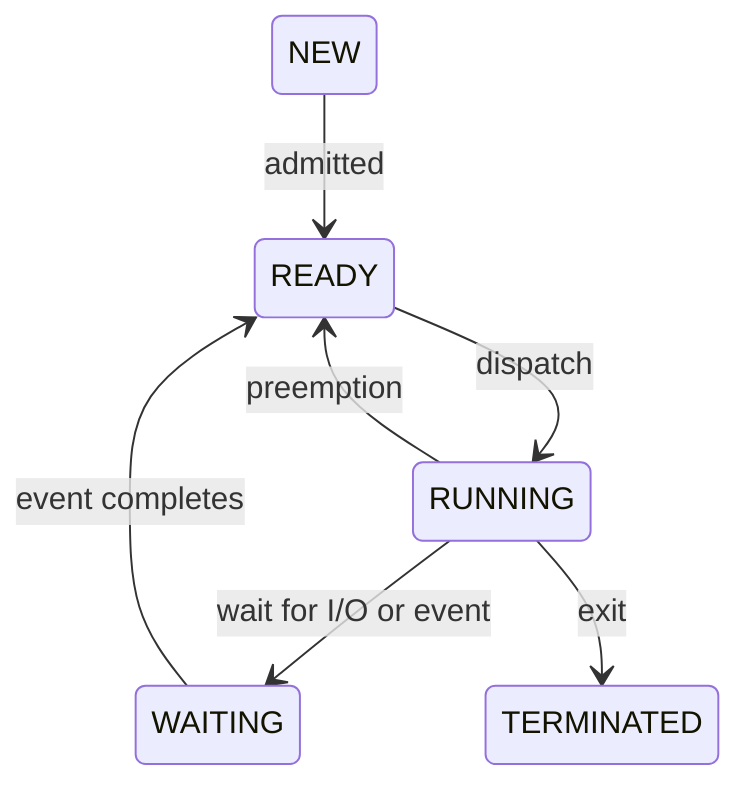

<!-- RO: TRADUS ȘI VERIFICAT -->
# C03_02_CONCEPT_MAP.md
# Concept Map — Processes

```
                    ┌─────────────┐
                    │   PROCESS   │
                    │ (program in │
                    │  execution) │
                    └──────┬──────┘
         ┌─────────────────┼─────────────────┐
         ▼                 ▼                 ▼
    ┌─────────┐      ┌─────────┐      ┌─────────┐
    │   PCB   │      │ Address │      │Resources│
    │         │      │  Space  │      │         │
    └────┬────┘      └────┬────┘      └────┬────┘
         │                │                │
    ┌────┴────┐      ┌────┴────┐      ┌────┴────┐
    │• PID    │      │• Code   │      │• Files  │
    │• State  │      │• Data   │      │• Sockets│
    │• Regs   │      │• Stack  │      │• Pipes  │
    │• Priority│     │• Heap   │      │• Signals│
    └─────────┘      └─────────┘      └─────────┘
```

## Process States



This single-CPU teaching model permits at most one RUNNING process. An I/O completion makes a blocked process READY; it does not automatically dispatch it.

## fork() + exec()
```
Parent Process (PID=100)
        │
        │ fork()
        ▼
    ┌───────────────────────────────┐
    │                               │
    ▼                               ▼
Parent (PID=100)            Child (PID=101)
return 101                  return 0
    │                               │
    │                               │ exec-family call: execlp("ls", "ls", NULL)
    │                               ▼
    │                       New image (ls)
    │                               │
    │ wait()                        │
    │◄──────────────────────────────┘
    ▼                          exit()
Continues
```
