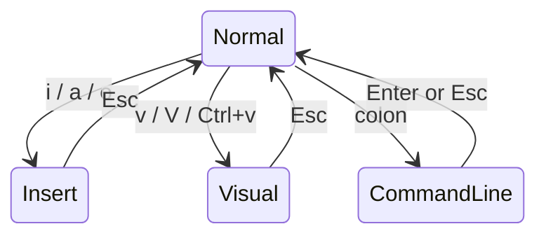

# S04_TC05 - Terminal Text Editors

> **Evidence limit:** local recordings, logs and hashes can support review of a submitted session; they do not prove authorship, uninterrupted capture or the absence of edited/omitted activity. Privacy, retention and assessment consequences remain subject to the approved course policy.

> **Operating Systems** | ASE Bucharest - CSIE  
> Laboratory Material - Seminar 4 (MODIFIED - includes nano and vim)

---

> 🚨 **BEFORE STARTING THE ASSIGNMENT**
>
> 1. Download and configure the `002HWinit` package (see STUDENT_GUIDE_EN.md)
> 2. Open a terminal and navigate to `~/HOMEWORKS`
> 3. Start recording with:
>    ```bash
>    python3 record_homework_tui_EN.py
>    ```
>    or the Bash variant:
>    ```bash
>    ./record_homework_EN.sh
>    ```
> 4. Complete the requested data (name, group, assignment number)
> 5. **ONLY THEN** start solving the requirements below

---

## Objectives

At the end of this laboratory, the student will be able to:
- Use the `nano` editor for quick edits
- Navigate efficiently in VI/VIM
- Edit text in different modes
- Choose the appropriate editor for each situation

---


## Part I: Nano

Use the [Nano module in the main material](../../docs/S04_02_MAIN_MATERIAL.md#module-5-nano---simple-text-editor)
for the complete walkthrough. In Nano 7.x, `Ctrl+S` saves and `Ctrl+T` opens the
execute-command menu; the visible help/footer is authoritative for the installed
version and configuration. Neither nano nor vim is guaranteed in a minimal image.
Check `command -v nano` / `command -v vim` before the lab.

## Part II: The VI/VIM Editor

### 2. Introduction to VI/VIM

**VI** (Visual Editor) is a traditional Unix editor. Minimal/container images may omit it.
**VIM** (VI IMproved) is the enhanced version with additional features.

### 2.1 Why VI/VIM?

- Common on Unix/Linux installations; verify availability in the actual lab image
- Very fast for text editing
- Works in terminal (SSH, servers)
- Extremely configurable and extensible
- High productivity once learned

### 2.2 Operating Modes



**Normal Mode** - the default mode, for commands and navigation
**Insert Mode** - for text editing (`i`, `a`, `o`)
**Visual Mode** - for selection (`v`, `V`, `Ctrl+v`)
**Command-Line Mode** - for Ex commands (`:`)

### 2.3 VIM Survival Commands

```text
# ENTRY
vim file.txt        # open file
i                   # enter Insert mode

# EXIT (from Normal mode)
:w                  # save
:q                  # quit
:wq                 # save and quit
:q!                 # quit WITHOUT saving (forced)
ZZ                  # save and quit (shortcut)

# RETURN TO NORMAL
ESC                 # always returns to Normal mode
```

### 2.4 Navigation in VIM (Normal Mode)

```text
# Basic movements
h j k l           # left, down, up, right

# By words
w                 # next word (beginning)
e                 # next word (end)
b                 # previous word

# By lines
0                 # beginning of line
$                 # end of line
^                 # first non-space character

# By file
gg                # beginning of file
G                 # end of file
:10               # line 10
```

### 2.5 Editing in VIM

```text
# Insert text
i                 # insert before cursor
a                 # append after cursor
o                 # new line below
O                 # new line above
I                 # insert at beginning of line
A                 # append at end of line

# Delete
x                 # delete character
dd                # delete line
dw                # delete word
d$                # delete to end of line
D                 # same as d$

# Copy and paste
yy                # copy (yank) line
yw                # copy word
p                 # paste after cursor
P                 # paste before cursor

# Undo/Redo
u                 # undo
Ctrl+r            # redo
```

### 2.6 Search and Replace in VIM

```text
# Search
/pattern          # search forward
?pattern          # search backward
n                 # next match
N                 # previous match

# Replace
:s/old/new/       # replace first on current line
:s/old/new/g      # replace all on current line
:%s/old/new/g     # replace in entire file
:%s/old/new/gc    # with confirmation
```

### 2.7 VIM Configuration in an Owned Fixture

Save the example as `vimrc` inside a fresh exercise directory, then use
`vim -u ./vimrc ./sample.txt`. Do not replace your personal `~/.vimrc` by default.

```vim
" Line numbers
set number
set relativenumber

" Syntax highlighting
syntax on

" Indentation
set tabstop=4
set shiftwidth=4
set expandtab
set autoindent

" Search
set hlsearch
set incsearch
set ignorecase
set smartcase

" Interface
set showcmd
set ruler
set wildmenu
```

---

## Part III: Comparison and Selection

### 3.1 When to use nano

✅ **Use nano for:**
- Quick configuration edits
- When you are new to Linux
- When you need something simple and intuitive
- Small modifications in text files

### 3.2 When to use vim

✅ **Use vim for:**
- Source code editing
- Long editing sessions
- When you need macros and automations
- On servers where nano is not installed
- Maximum productivity (after the learning curve)

### 3.3 Comparison Table

| Aspect | nano | vim |
|--------|------|-----|
| Learning curve | Easy | Steep |
| Availability | Verify installed command | Verify installed command |
| Initial productivity | High | Low |
| Expert productivity | Medium | Very high |
| Extensibility | Configuration/shortcuts | Configuration/plugins |
| Operating modes | One | Multiple |
| Shortcuts | Ctrl+X | Complex combinations |

---

## 4. Practical Exercises

### Exercise 1: nano
1. Open a new file with nano
2. Write 10 lines of text
3. Search and replace a word
4. Save and exit

### Exercise 2: vim
1. Open a file with vim
2. Navigate using h, j, k, l
3. Delete 3 lines with `3dd`
4. Undo with `u`
5. Save and exit with `:wq`

### Exercise 3: Comparison
Make two copies of a small synthetic configuration inside an owned exercise directory. Edit one with nano and one with vim, then compare the resulting files and the interaction. Do not edit your live `.bashrc` for this exercise.

---

## Combined Cheat Sheet

### nano
```
Ctrl+O  Save            Ctrl+K  Cut line
Ctrl+X  Exit            Ctrl+U  Paste
Ctrl+W  Search          Ctrl+\  Replace
Ctrl+G  Help            Ctrl+_  Go to line
```

### vim
```
i       Insert mode     ESC     Normal mode
:w      Save            :q      Quit
:wq     Save+Quit       :q!     Force quit
dd      Delete line     yy      Copy line
p       Paste           u       Undo
/text   Search          :%s/a/b/g  Replace
```

---

## References

- `man nano`
- `man vim`
- `vimtutor` - Interactive vim tutorial (run in terminal)
- [Vim Adventures](https://vim-adventures.com/) - Game for learning vim
- [OpenVim](https://www.openvim.com/) - Online interactive tutorial

---

## 📤 Completion and Submission

After you have completed all requirements:

1. **Stop recording** by typing:
   ```bash
   STOP_tema
   ```
   or press `Ctrl+D`

2. **Wait** - the script will:
   - Finalise the legacy recorder metadata envelope (not a content signature)
   - Automatically upload the file to the server

3. **Check the final message**:
   - ✅ `UPLOAD SUCCESSFUL!` - the assignment has been submitted
   - ❌ If the upload fails, the `.cast` file is saved locally - submit it manually later with the displayed command

> Keep the original `.cast` as evidence. The distributed recorder envelopes do not
> bind event content and do not authenticate the student. Local preflight exit 0
> establishes format only (`UNVERIFIED` authentication, `UNCONFIRMED` readiness).
> The separate SEM07 `# SIGNATURE:` contract binds a content digest only when it
> verifies with an explicitly supplied key; identity and institutional acceptance
> still require an approved protocol. See the [current recording contract](../../../03_GUIDES/RECORDING_CONTRACT.md)
> and [verification contract](../../../SEM07/homework_evaluation/VERIFICATION_AND_GRADING_CONTRACT.md).

---

*By Revolvix for OPERATING SYSTEMS class | restricted licence 2017-2030*
